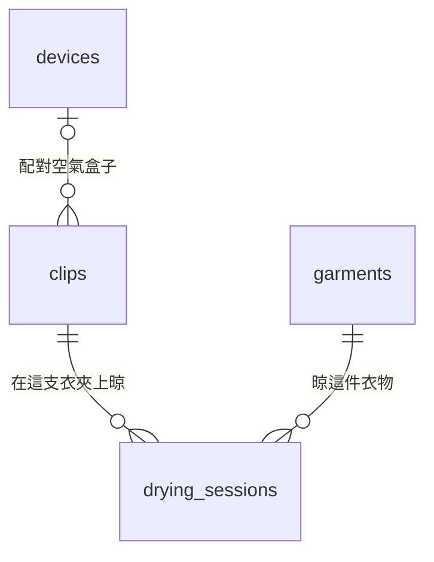

# 交接：後端資料表與 API

更新日期：2026-11-21。長期有效的專案說明在根目錄的 [CLAUDE.md](../CLAUDE.md)；這份文件只記錄目前進度和接下來要做的事，做完可以刪除。

## 目前狀態

- 分支 `feat/garments-sessions`，接在 `feat/clothes-redesign`（PR #12）後面開 PR（PR stack），要等 PR #12 合併後再合。照功能分成幾個 commit：全站設定（示範資料開關）→ 每支衣夾的設定 → 衣物庫和晾衣。
- migration：`002_app_settings.sql`、`003_clips.sql`、`004_garments_sessions.sql`（啟動時也會自動建表）。
- 衣夾 ID 先照現在一支做：`clothes/raw`、`clothes_raw` 沒有改，`clips` 只有 `c1`。多衣夾之後另外開分支處理。

## 這一輪做好的部分

| 項目 | 後端 | 前端 |
| --- | --- | --- |
| 示範資料開關 | `app_settings.demo_data`，`/api/v1/settings` | **已接上**：`useSettings.ts`，設定頁伺服器存好才切換 |
| 每支衣夾的設定（配對空氣盒子、預測方式、名稱） | `clips`，`GET/PATCH /clothes/clips` | **已接上**：空氣盒子選單、衣夾詳細的「預測使用」 |
| 衣物庫 | `garments`，`/clothes/garments` | 還沒接 |
| 晾衣中、晾衣紀錄、次數 | `drying_sessions`，`/clothes/sessions*` | 還沒接 |
| 預測（預計乾燥時間） | 歷史平均，沒有紀錄用材質預設值（`prediction.ts`） | 還沒接 |

資料表和 API 的細節在 CLAUDE.md。ER 圖：

`app_settings` 是獨立的 key-value 表；`clothes_raw` 和 session 用時間區間對應，不建 FK。

## 接下來要做的事

1. **前端衣物和晾衣改用 API**：把 `useClothesMock.ts` 在「示範資料關閉」時用的 `clothes-local-v1`（`addGarment`、`updateGarment`、`startSession`、`swapGarment`、`endSession`）換成 `/clothes/garments`、`/clothes/sessions`。示範資料 `clothes-demo-v1` 繼續留在 localStorage。欄位對應：`totalMin` ↔ `predicted_min`，`actualMin` ↔ `actual_min`，`startedAt` ↔ `started_at`。
2. **統計**：後端目前只有紀錄和 `total`。平均乾燥時間、誤差、各材質平均之後再決定怎麼做。
3. **剩餘水分 %**、用重量曲線修正預測：還沒做。
4. **多衣夾**：`clothes_raw` 加 `clip_id`、topic 改成可以分辨衣夾，`clips` 加列；`listClips()` 裡「`clothes_raw` 都算 `c1`」的判斷要跟著改。
5. 其他沿用之前的清單：戶外天氣（`feat/outdoor-weather`）、連線事件、空夾歸零（韌體要先能收指令）。

## 驗證方式

- `make test`：後端單元測試，沒有資料庫時各端點應該回 503。
- 有資料庫時的完整流程（建衣物 → 開始 → 重複開始得 409 → 換衣物 → dry 結束 → 紀錄和 `dry_count` → cancel）已經用 curl 跑過；測試資料跑完後已經刪掉。
